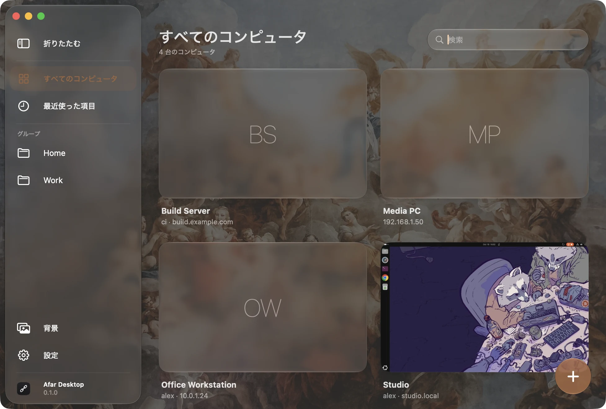
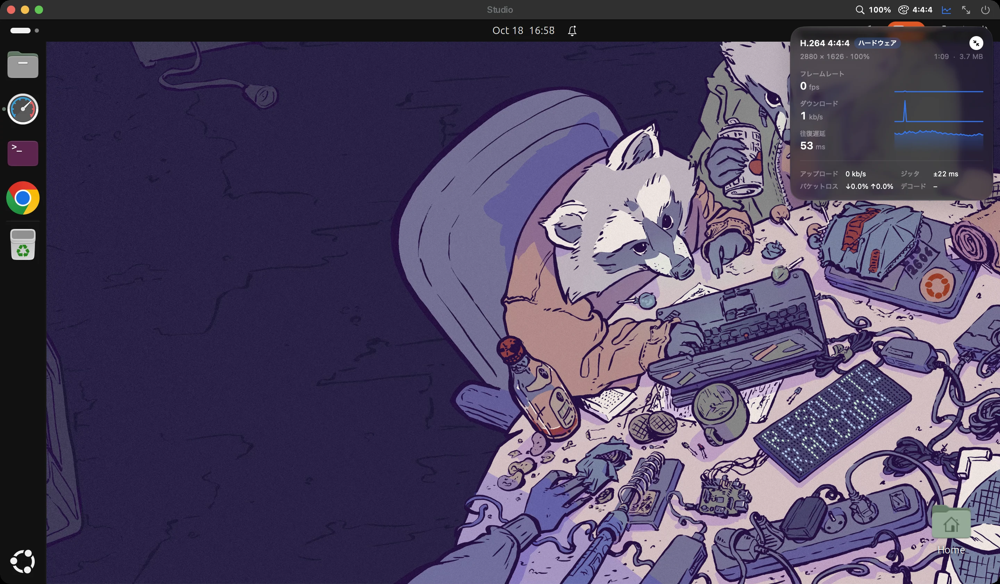

# Afar Desktop

RDP（[FreeRDP](https://www.freerdp.com) ベース）と VNC に対応した Mac 用リモートデスクトップクライアント。

Afar Desktop はコンピュータを 1 つの Liquid Glass ウインドウにまとめ、セッションごとにネイティブのウインドウを開きます。
リモートデスクトップはそのウインドウに追従します。サイズを変えたり、別のディスプレイに移したり、フルスクリーンにしたりすると、
リモート側の解像度が自動で合わせられ、Retina ディスプレイでも文字はくっきり表示されます。

[English](README.md) · [简体中文](README.zh-CN.md)





## 機能

- **接続の保存**：名前、グループ、検索に対応し、各コンピュータの前回のデスクトップをプレビューとして表示します。
- **パスワードは macOS のキーチェーンに保存**：標準のインターネットパスワード項目（`rdp://ホスト`）で、ファイルには書き込みません。
- **動的解像度**：RDP のディスプレイ制御チャネルで、リモートデスクトップがウインドウのサイズに追従します。固定解像度も選べます。
- **レンダリング倍率**：リモートデスクトップをウインドウのピクセルの 100、80、67、50 % で描画し、Mac 側で拡大表示します。
  遅い回線でもエンコードと転送の量が減り、リモート側のインターフェイスの大きさは変わりません。セッションのタイトルバーからすぐに切り替えられます。
- **カラー**：H.264 4:4:4（AVC444）は色付きの文字が最も鮮明で、4:2:0（AVC420）はデータ量とデコードの負荷が大幅に少なくなります。
  タイトルバーから切り替えられ、セッションが再接続されて反映されます。
- **接続の統計情報**：フレームレート、帯域、往復遅延とジッタ、パケットロス、デコード時間、コーデック。
  1 分間のグラフ付きパネルか 1 行の表示を選べ、デスクトップ上の好きな位置にドラッグできます。
- **ネイティブのセッションウインドウ**：接続ごとに新しいウインドウ（またはタブ）で開き、ネイティブのフルスクリーンに対応し、
  リモートのカーソルは本物の macOS カーソルとして表示されます。
- **キーボード**は物理キーの位置で対応付けます。⌘ は Ctrl（⌘C / ⌘V が Mac と同じように動きます）としても、
  Windows / Super キーとしても使え、接続ごとに設定できます。
- **ハードウェアによる映像デコード**：H.264（AVC420 と、文字が鮮明な AVC444）を VideoToolbox でデコードするので、
  滑らかな映像でも CPU をほとんど使いません。
- **クリップボードの共有**：テキスト、画像、ファイルを双方向にやり取りできます。Mac でコピーしたファイルはリモート側で
  ペーストしたときに読み込まれ、リモートでコピーしたファイルは Finder にペーストできるようダウンロードされます
  （100 MB までは自動、それより大きい場合は確認してから）。
- **`.rdp` ファイル**：読み込み（メニュー、ウインドウへのドラッグ、ファイルのダブルクリックで接続）と書き出しに対応し、
  Microsoft のクライアントと互換性があります。パスワードはファイルに書き込みません。
- **リモートデスクトップゲートウェイ**：コンピュータと同じ資格情報でも、別の資格情報でも使えます。
- **VNC**（新機能。まだ十分にテストしていないため、不安定だったり不具合があったりする場合があります）：
  Raspberry Pi、TigerVNC、x11vnc などの Linux サーバ、macOS の画面共有に接続できます。サーバはパスワードによる
  サインインを使う必要があります。RealVNC Server では認証を「VNC パスワード」にしてください。
  - サインイン：TLS 上の VeNCrypt（X.509 証明書は RDP と同じように確認）、Apple の Diffie-Hellman ログイン、
    VNC パスワード、またはなし。
  - 画像：Tight（カラーで「通信量が少ない」を選ぶと JPEG）、ZRLE、Hextile、CopyRect、Raw。
  - サーバが解像度を変えられる場合はウインドウに追従し、変えられない場合は縦横比を保って縮小・拡大します。
    カーソルは Mac 側で描画します。
  - 拡張クリップボードに対応したサーバとは Unicode のテキストを双方向に、それ以外とは Latin-1 でやり取りします。
  - サーバが対応していればキーをスキャンコードで送るので、リモート側のキーボード配列がそのまま使えます。
- **RDP か VNC かを自動判別**：アドレスを入力すると判別し、カードにはプロトコルのタグが付きます。手動でも選べます。
- **証明書の確認**：未知の証明書や変更された証明書は、接続前に指紋とともに表示されます。
- macOS 26 以降は Liquid Glass、それ以前はマテリアルの外観です。メインウインドウの背景は付属の画像、自分の画像、単色から選べ、
  アクセントカラーは背景から選ばれます。
- 英語、簡体字中国語、繁体字中国語、日本語、韓国語、フランス語、イタリア語に対応。システムの言語に従い、設定で別の言語も選べます。

予定していないこと：1 つのセッションで複数のディスプレイにまたがる表示。

VNC の制限：プロトコルにサウンドとファイル転送はありません。RealVNC 独自の暗号化（RSA-AES）にはまだ対応していないため、
RealVNC Server では「VNC パスワード」認証が必要です。

## 動作環境

macOS 14 Sonoma 以降。ビルドには Xcode 16 以降、CMake、Ninja（`brew install cmake ninja`）が必要です。

## ビルド

```bash
scripts/build-deps.sh          # 固定バージョンのソースから OpenSSL と FreeRDP をビルド（初回のみ）
scripts/build-app.sh --install # アプリをビルドして /Applications にインストールし、起動
```

- `scripts/build-deps.sh` は `Vendor/versions.env` で固定したバージョンをダウンロードし、SHA-256 を確認して
  `Vendor/patches/`（VideoToolbox デコーダ）を適用し、静的ライブラリを `Vendor/prefix` にビルドします。
  Homebrew のライブラリは使いません。`ARCHS="arm64 x86_64" scripts/build-deps.sh` でユニバーサルライブラリをビルドできます。
- `scripts/build-app.sh` はリリース版のアプリをビルドします。`--install` を付けない場合は `build/stage.noindex/` に置かれます。
- `scripts/test.sh` はユニットテストを実行し、`scripts/clean.sh` はビルド成果物を削除します（`--all` でサードパーティのビルドも削除）。
- 環境変数 `AFAR_DATA_DIR=フォルダ` を指定すると、接続、プレビュー、キャッシュをそのフォルダに保存するので、
  自分のデータに触れずに試せます（`defaults` の設定は共有されます）。

### 署名

既定ではアドホック署名です。自分の署名 ID とバンドル ID を使うには、`config/signing.example.env` を
`config/signing.env`（git の対象外）にコピーして記入してください。署名 ID が固定されていれば、
再ビルドしてもキーチェーンへのアクセスを繰り返し尋ねられません。

### リリース

`scripts/package-release.sh` はアプリをビルドし、Developer ID で署名、公証、ステープルしてから
`build/AfarDesktop-<バージョン>.zip` と SHA-256 を作ります。`config/signing.env` に `SIGN_IDENTITY` と `NOTARY_PROFILE` が必要です。
ユニバーサル版にするには、先に `ARCHS="arm64 x86_64" scripts/build-deps.sh` でライブラリをビルドしてください。

## データの保存場所

| 内容 | 場所 |
| --- | --- |
| 保存した接続 | `~/Library/Application Support/Afar Desktop/connections.json` |
| デスクトップのプレビュー | `~/Library/Application Support/Afar Desktop/Thumbnails/`（接続ごとに 1 枚、接続中に更新） |
| 自分の背景画像 | `~/Library/Application Support/Afar Desktop/Backdrop.jpg`（任意） |
| リモートのクリップボードからダウンロードしたファイル | `~/Library/Caches/Afar Desktop/Clipboard/`（起動時に消去） |
| 受け入れた証明書 | `~/Library/Application Support/Afar Desktop/FreeRDP/server/`（RDP）と `…/VNC/certificates/`（VNC、SHA-256 指紋）、ホストとポートごとに 1 つ |
| パスワード | ログインキーチェーン、種類「インターネットパスワード」、`rdp://ホスト` または `vnc://ホスト`（ゲートウェイのパスワードはゲートウェイのホスト名で保存） |
| 設定とウインドウの位置 | `defaults read <バンドル ID>` |

接続を削除するとプレビューも削除され、ほかの接続で使っていなければパスワードと証明書も削除されます。

## 構成

```
Sources/AfarEngine   FreeRDP の C ラッパー。役割ごとにファイルを分割：Session（ライフサイクル、認証、証明書）、
                     Display（IOSurface の画面、カーソル、ディスプレイ制御）、Input、Clipboard と ClipboardFiles、
                     Statistics、Keymap。VNC 用に Stream（OpenSSL による TCP と TLS）と Codec（zlib、DH）
Sources/AfarKit      UI を持たない Swift 層。Session/：両プロトコルが実装する RemoteSession インターフェイス。
                     RDP/：RDPSession と .rdp ファイル。VNC/：VNC クライアント（セキュリティ、デコーダ、キー対応、
                     拡張クリップボード）。ほかに接続とその保存、キーチェーン、プロトコル判別、クリップボードの形式、レイアウト
Sources/AfarDesktop  アプリ本体：SwiftUI のメインウインドウと設定、AppKit のセッションウインドウ。
                     Liquid Glass の OS バージョン判定はすべて Design/Glass.swift にあります
Sources/afar-probe   開発用のコマンドライン接続チェック。RDP と VNC に対応（フレーム、リサイズ、入力、クリップボードのテキストとファイル、統計情報、プロトコル判別）
Vendor/patches       FreeRDP への変更：VideoToolbox による H.264 デコーダ
Resources            Info.plist、文字列カタログ（Localizable、InfoPlist）、AppIcon.icon（Icon Composer で開けます）、背景画像
```

エンジンは少数の IOSurface に順番に描画し、セッションビューはそれをそのままレイヤーの内容として表示するので、
フレームはメインスレッドでコピーされることなく画面に届きます。

インターフェイスの文字列はコード内に英語で書かれています。`scripts/build-app.sh` が `tools/sync-strings.py` を通して
`Resources/Localizable.xcstrings` に集め、翻訳が足りない文字列を一覧にします。翻訳はこのカタログ（Xcode または JSON）で編集します。

## ライセンス

Apache License 2.0。FreeRDP、OpenSSL、背景画像（Unsplash ライセンス）については [LICENSE](LICENSE)、[NOTICE](NOTICE)、
[THIRD_PARTY_NOTICES.md](THIRD_PARTY_NOTICES.md) をご覧ください。
