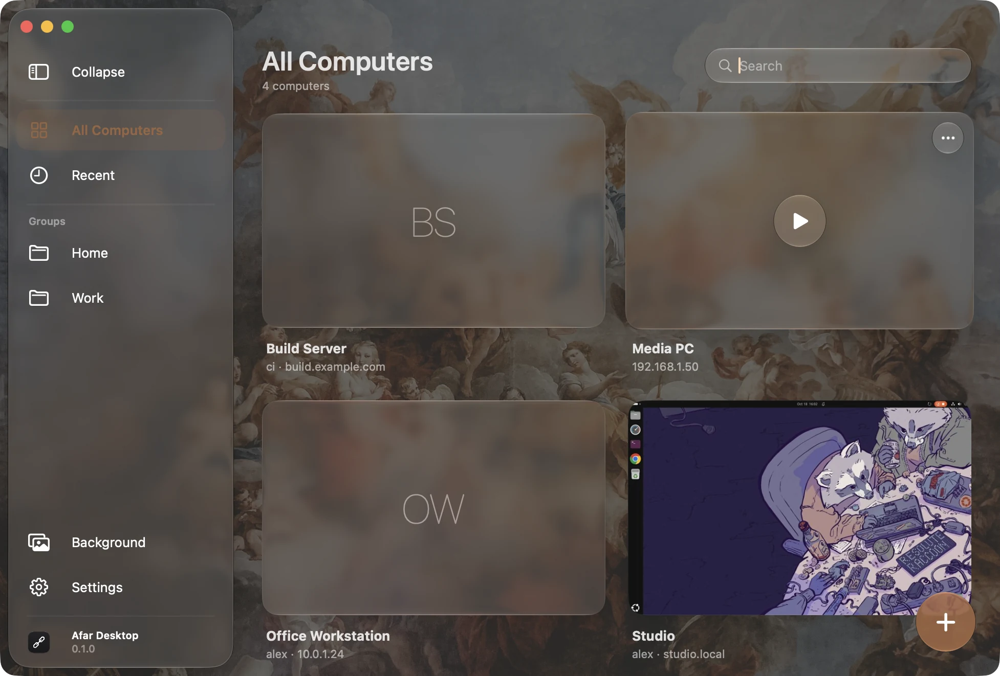
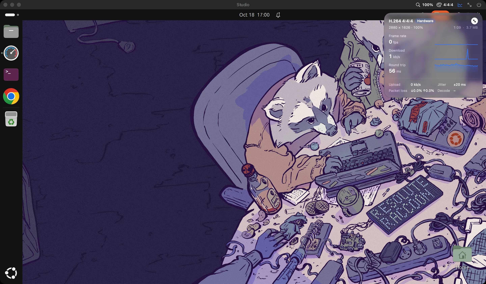

# Afar Desktop

A remote desktop client for the Mac, for RDP (built on [FreeRDP](https://www.freerdp.com)) and
VNC.

Afar Desktop keeps your computers in one Liquid Glass window, opens each session in its own
native window, and makes the remote desktop follow that window: resize it, move it to another
display or go full screen, and the remote side adjusts its resolution to match, with sharp
Retina text.

[简体中文](README.zh-CN.md) · [日本語](README.ja.md)





## Features

- **Saved connections** with custom names, groups, search and a preview of each desktop as you
  last left it.
- **Passwords in the macOS Keychain** as standard internet-password items (`rdp://host`), never
  in files. Nothing secret is stored anywhere else.
- **Dynamic resolution**: the remote desktop follows the window size through the RDP display
  control channel. Fixed resolutions are available too.
- **Render scale**: the remote desktop can draw at 100, 80, 67 or 50 % of the pixels the window
  covers, and the Mac scales the image up. Less to encode and send on a slow link, while the
  remote interface keeps its size. It changes live from the session's title bar.
- **Colour**: H.264 4:4:4 (AVC444) for the sharpest coloured text, or 4:2:0 (AVC420) for much less
  data and decoding work. Switched from the title bar; the session reconnects to apply it.
- **Connection statistics**: frame rate, bandwidth, round trip and jitter, packet loss, decoding
  time and codec. Shown as a panel with one-minute graphs or as a single line, dragged anywhere
  over the desktop.
- **Native sessions**: each connection opens in a new window (or a tab, if you prefer), with
  native full screen and the remote cursor shown as a real macOS cursor.
- **Keyboard** mapped by physical key position; ⌘ can act as Ctrl (so ⌘C / ⌘V work as on the
  Mac) or as the Windows / Super key, per connection.
- **Hardware video decoding**: H.264 (AVC420 and AVC444, the sharp-text mode) is decoded by
  VideoToolbox, so smooth video costs little CPU.
- **Shared clipboard**: text, images and files in both directions. Files copied on the Mac are
  read when the remote side pastes; files copied on the remote computer are downloaded for
  pasting in Finder (automatically up to 100 MB, after a prompt above that).
- **`.rdp` files**: import (menu, drag onto the window, or double-click a file to connect) and
  export, compatible with Microsoft's clients. Passwords are never written to the file.
- **Remote Desktop Gateway**, with the computer's credentials or its own.
- **VNC**, for Raspberry Pi (wayvnc and RealVNC in its VNC-password mode), TigerVNC, x11vnc and
  other Linux servers, and macOS Screen Sharing:
  - sign-in with VeNCrypt over TLS (X.509 certificates are checked like RDP's), Apple's
    Diffie-Hellman login, a VNC password, or none;
  - Tight (with JPEG when colour is set to less data), ZRLE, Hextile, CopyRect and Raw images;
  - the remote desktop follows the window where the server can resize, and is scaled to fit
    where it cannot; the remote cursor is drawn by this Mac;
  - Unicode text in both directions on servers with the extended clipboard, Latin-1 elsewhere;
  - keys sent as scancodes where the server takes them, so its own keyboard layout applies.
- **RDP or VNC is found out** when you type the address, and every card is tagged with its
  protocol; you can also choose it yourself.
- **Certificate checks**: unknown or changed certificates are shown with their fingerprint
  before you connect.
- Liquid Glass on macOS 26 and later, with a material look on earlier versions. The main
  window's background is one of the included pictures, your own picture or a solid colour, and
  sets the highlight colour.
- In English, Simplified and Traditional Chinese, Japanese, Korean, French and Italian. The app
  follows the system language; Settings can choose another one.

Not planned: spanning several displays with one session.

VNC limits: there is no sound or file transfer in the protocol. RealVNC's own encryption
(RSA-AES) is not supported yet: set RealVNC Server to "VNC password" authentication. Signing in
to macOS Screen Sharing is implemented from its published description and has not been tested
on a Mac yet.

## Requirements

macOS 14 Sonoma or later. Building needs Xcode 16 or later, CMake and Ninja
(`brew install cmake ninja`).

## Building

```bash
scripts/build-deps.sh          # builds OpenSSL and FreeRDP from pinned sources (once)
scripts/build-app.sh --install # builds the app, installs it to /Applications and opens it
```

- `scripts/build-deps.sh` downloads the versions pinned in `Vendor/versions.env`, checks their
  SHA-256 hashes, applies `Vendor/patches/` (the VideoToolbox decoder) and builds static
  libraries into `Vendor/prefix`. Nothing is taken from Homebrew. `ARCHS="arm64 x86_64" scripts/build-deps.sh` builds universal libraries.
- `scripts/build-app.sh` builds a release app bundle. Without `--install` it stays in
  `build/stage.noindex/`.
- `scripts/test.sh` runs the unit tests; `scripts/clean.sh` removes build products
  (`--all` also removes the third-party builds).
- `AFAR_DATA_DIR=/some/folder` in the environment makes the app keep its connections, previews
  and caches in that folder, for trying things out without touching your own (settings in
  `defaults` stay shared).

### Signing

Builds are signed ad hoc by default. To use your own identity and bundle identifier, copy
`config/signing.example.env` to `config/signing.env` (ignored by git) and fill it in. With a
stable identity, macOS remembers Keychain access across rebuilds.

### Releases

`scripts/package-release.sh` builds, signs with a Developer ID identity, notarizes, staples and
zips the app into `build/AfarDesktop-<version>.zip` with its SHA-256. It needs `SIGN_IDENTITY`
and `NOTARY_PROFILE` in `config/signing.env`. Build the libraries with
`ARCHS="arm64 x86_64" scripts/build-deps.sh` first for a universal app.

## Where data lives

| What | Where |
| --- | --- |
| Saved connections | `~/Library/Application Support/Afar Desktop/connections.json` |
| Desktop previews | `~/Library/Application Support/Afar Desktop/Thumbnails/` (one per connection, refreshed while connected) |
| Your own background picture | `~/Library/Application Support/Afar Desktop/Backdrop.jpg` (optional) |
| Files downloaded from remote clipboards | `~/Library/Caches/Afar Desktop/Clipboard/` (emptied at launch) |
| Accepted certificates | `~/Library/Application Support/Afar Desktop/FreeRDP/server/` (RDP) and `…/VNC/certificates/` (VNC, a SHA-256 fingerprint), one per host and port |
| Passwords | Login Keychain, kind "internet password", `rdp://host` or `vnc://host` (gateway passwords under the gateway's host) |
| Settings and window positions | `defaults read <bundle id>` |

Deleting a connection removes its preview, and its password and certificate when no other
connection uses them.

## Architecture

```
Sources/AfarEngine   C glue over FreeRDP, one file per concern: Session (lifecycle,
                     authentication, certificates), Display (IOSurface framebuffer, cursor,
                     display control), Input, Clipboard and ClipboardFiles, Statistics, Keymap;
                     and for VNC, Stream (TCP and TLS over OpenSSL) and Codec (zlib, DH)
Sources/AfarKit      Swift, no UI. Session/: the RemoteSession interface both protocols implement.
                     RDP/: RDPSession (wraps the engine) and .rdp files. VNC/: the VNC client
                     (security, decoders, keymap, extended clipboard). Also connections and their
                     store, Keychain, protocol detection, clipboard formats, desktop layout
Sources/AfarDesktop  The app: SwiftUI library and settings, AppKit session windows;
                     Design/Glass.swift holds every Liquid Glass availability check
Sources/afar-probe   Command-line connection check for development, RDP or VNC (frames,
                     resizing, typing, clipboard text and files, statistics, protocol detection)
Vendor/patches       Changes to FreeRDP: a VideoToolbox H.264 decoder
Resources            Info.plist, the string catalogs (Localizable, InfoPlist), AppIcon.icon
                     (open it in Icon Composer) and the background pictures
```

Interface text is written in English in the code. `scripts/build-app.sh` collects it into
`Resources/Localizable.xcstrings` (through `tools/sync-strings.py`) and lists any string still
missing a translation; translations are edited in that catalog, in Xcode or as JSON.

The engine renders into a small ring of IOSurfaces that the session view shows directly as
its layer contents, so frames reach the screen without copies on the main thread.

## License

Apache License 2.0. See [LICENSE](LICENSE), [NOTICE](NOTICE) and
[THIRD_PARTY_NOTICES.md](THIRD_PARTY_NOTICES.md) for FreeRDP, OpenSSL and the background pictures
(Unsplash License).
