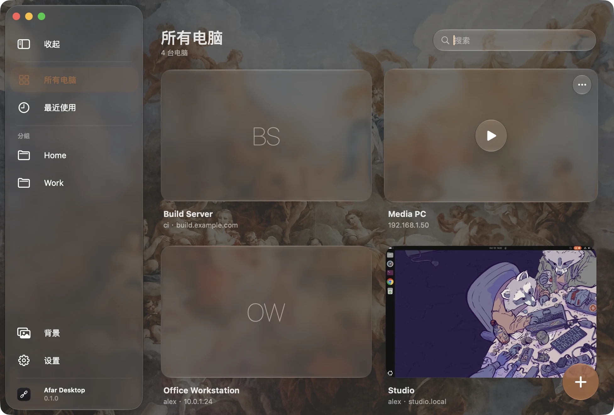
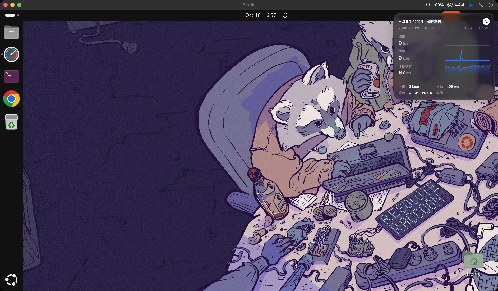

# Afar Desktop

基于 [FreeRDP](https://www.freerdp.com) 的 Mac 远程桌面（RDP）客户端。

Afar Desktop 把你的电脑集中在一个 Liquid Glass 窗口里管理，每个会话在独立的原生窗口中打开，远程桌面跟随窗口变化：
拉伸窗口、拖到另一块屏幕或进入全屏，远端都会自动调整分辨率，Retina 屏上文字清晰。

[English](README.md) · [日本語](README.ja.md)





## 功能

- **保存连接**：自定义名称、分组、搜索，每台电脑显示上次离开时的桌面预览。
- **密码存在 macOS 钥匙串**：标准的互联网密码条目（`rdp://主机`），不写入任何文件。
- **自适应分辨率**：通过 RDP 显示控制通道，远程桌面随窗口大小变化；也可以选固定分辨率。
- **渲染比例**：远端可以只画窗口像素的 100%、80%、67% 或 50%，再由 Mac 放大显示。慢速网络下要编码和传输的画面更少，远端界面大小保持不变。在会话窗口的标题栏随时切换。
- **色彩**：H.264 4:4:4（AVC444）彩色文字最清晰；4:2:0（AVC420）的数据量和解码负担都小得多。在标题栏切换，会话会自动重连生效。
- **连接统计**：帧率、带宽、往返延迟和抖动、丢包、解码耗时和编码格式。可以显示为带一分钟曲线的面板，也可以收成一行，拖到桌面上任意位置。
- **原生会话窗口**：每个连接默认开新窗口（也可以用标签页），支持原生全屏，远端光标显示为真正的 macOS 光标。
- **键盘**按物理键位映射；⌘ 可以当 Ctrl 用（⌘C / ⌘V 和在 Mac 上一样），也可以当 Windows / Super 键，每个连接单独设置。
- **硬件视频解码**：H.264（AVC420 和让文字更清晰的 AVC444）由 VideoToolbox 解码，画面流畅且几乎不占 CPU。
- **共享剪贴板**：文字、图片、文件双向互通。在 Mac 上复制的文件，远端粘贴时才读取；在远端复制的文件会下载下来供 Finder 粘贴（100 MB 以内自动下载，更大的先询问）。
- **`.rdp` 文件**：可以导入（菜单、拖进窗口，或双击文件直接连接），也可以导出，与微软客户端兼容。文件里不写密码。
- **RD 网关**：可以沿用电脑的凭据，也可以单独设置。
- **证书检查**：遇到陌生或变更的证书，连接前显示指纹供核对。
- macOS 26 及以上使用 Liquid Glass，更早的系统使用毛玻璃材质。主窗口背景可以选内置图片、自己的图片或纯色，强调色随背景自动选取。
- 界面支持英文、简体中文、繁体中文、日文、韩文、法文和意大利文，默认跟随系统语言，也可以在设置里另选。

不打算做：一个会话横跨多块显示器。

## 系统要求

macOS 14 Sonoma 及以上。编译需要 Xcode 16 及以上、CMake 和 Ninja（`brew install cmake ninja`）。

## 编译

```bash
scripts/build-deps.sh          # 从固定版本的源码编译 OpenSSL 和 FreeRDP（只需一次）
scripts/build-app.sh --install # 编译 app，安装到“应用程序”并打开
```

- `scripts/build-deps.sh` 下载 `Vendor/versions.env` 中固定的版本，校验 SHA-256，应用 `Vendor/patches/` 里的补丁（VideoToolbox 解码器）后编译成静态库，放在 `Vendor/prefix`，不依赖 Homebrew 里的任何库。`ARCHS="arm64 x86_64" scripts/build-deps.sh` 可编译通用二进制。
- `scripts/build-app.sh` 编译 release 版 app；不加 `--install` 时留在 `build/stage.noindex/`。
- `scripts/test.sh` 运行单元测试；`scripts/clean.sh` 清理编译产物（加 `--all` 连第三方库一起清理）。
- 环境变量 `AFAR_DATA_DIR=某个文件夹` 会让 app 把连接、预览图和缓存放进这个文件夹，方便试验而不动自己的数据（`defaults` 里的设置仍然共用）。

### 签名

默认用临时签名（ad hoc）。要用自己的证书和 Bundle ID，把 `config/signing.example.env` 复制为 `config/signing.env`（不进 git）并填写。签名身份固定后，重新编译也不会反复询问钥匙串权限。

### 发布

`scripts/package-release.sh` 会编译 app，用 Developer ID 签名、公证、装订（staple），打包成 `build/AfarDesktop-<版本>.zip` 并附上 SHA-256。需要在 `config/signing.env` 里填好 `SIGN_IDENTITY` 和 `NOTARY_PROFILE`。要出通用版，先用 `ARCHS="arm64 x86_64" scripts/build-deps.sh` 编译依赖库。

## 数据存放位置

| 内容 | 位置 |
| --- | --- |
| 保存的连接 | `~/Library/Application Support/Afar Desktop/connections.json` |
| 桌面预览图 | `~/Library/Application Support/Afar Desktop/Thumbnails/`（每个连接一张，连接期间定时更新） |
| 自己的背景图 | `~/Library/Application Support/Afar Desktop/Backdrop.jpg`（可选） |
| 从远端剪贴板下载的文件 | `~/Library/Caches/Afar Desktop/Clipboard/`（每次启动时清空） |
| 已信任的证书 | `~/Library/Application Support/Afar Desktop/FreeRDP/server/`（每台主机一个） |
| 密码 | 登录钥匙串，种类为“互联网密码”，`rdp://主机`（网关密码记在网关主机名下） |
| 设置与窗口位置 | `defaults read <bundle id>` |

删除连接时会删除它的预览图；如果没有其他连接在用，也会删除对应的密码和证书。

## 结构

```
Sources/AfarEngine   FreeRDP 的 C 封装，按职责分文件：Session（生命周期、认证、证书）、
                     Display（IOSurface 画面、光标、显示控制）、Input、Clipboard 与 ClipboardFiles、Statistics、Keymap
Sources/AfarKit      不含界面的 Swift 层：RDPSession、连接与存储、钥匙串、.rdp 文件、
                     剪贴板格式、分辨率换算
Sources/AfarDesktop  app 本身：SwiftUI 主窗口与设置、AppKit 会话窗口；
                     Liquid Glass 的系统版本判断全部集中在 Design/Glass.swift
Sources/afar-probe   开发用的命令行测试工具（画面、改分辨率、剪贴板文字和文件、统计数据）
Vendor/patches       对 FreeRDP 的改动：VideoToolbox H.264 解码器
Resources            Info.plist、字符串目录（Localizable、InfoPlist）、图标 AppIcon.icon（可用 Icon Composer 打开）和内置背景图
```

界面文字在代码里用英文书写。`scripts/build-app.sh` 会通过 `tools/sync-strings.py` 把它们收集进 `Resources/Localizable.xcstrings`，并列出还缺翻译的条目；翻译直接在这个目录文件里修改（用 Xcode 或当作 JSON 编辑都可以）。

## 许可证

Apache License 2.0。FreeRDP、OpenSSL 与内置背景图（Unsplash 许可）的说明见 [LICENSE](LICENSE)、[NOTICE](NOTICE) 和 [THIRD_PARTY_NOTICES.md](THIRD_PARTY_NOTICES.md)。
